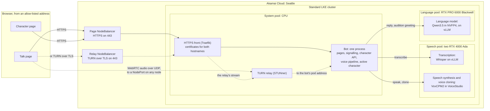
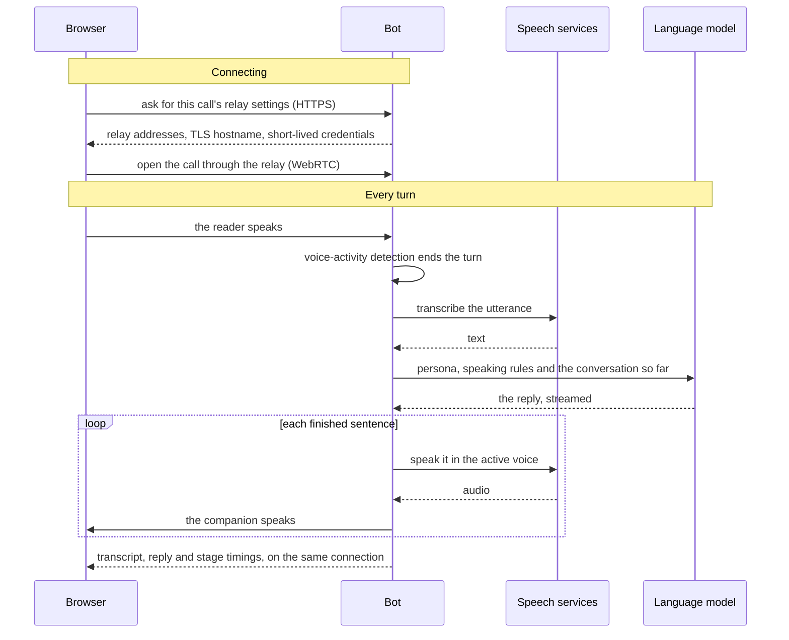
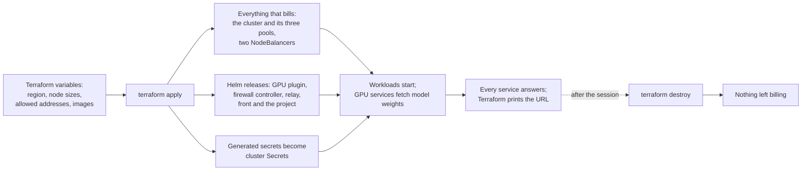

# Voice Companion Loop: architecture overview

**Status:** the grounded design as of 2026-10-13: the reviewed design, with its concrete services
chosen. [Still to validate](#still-to-validate) lists what has yet to be tested. Why the demo runs this
way on LKE, and the terms used here, are covered in
[compute-platform-options.md](compute-platform-options.md).

## What it is

The Voice Companion Loop is a live, spoken conversation with an AI character. You talk in a browser;
the companion hears you, answers in character, and speaks the answer in its own voice, turn after turn.
A second page reshapes the character: a persona composed from a few characteristics, and a voice cloned
from a few seconds of speech. Apply it mid-conversation, and the next reply comes from the new character,
on the same call, with the conversation so far intact.

Everything runs on Akamai Cloud: open models on Akamai GPUs, on standard LKE in Seattle, brought up and
torn down by Terraform. The design has three parts, each something the reader does:

| Part | The reader... | What it shows |
|---|---|---|
| **Talk to the companion** | talks in the browser and hears each reply, with every stage's timing on screen | real-time voice over WebRTC; open models hearing, answering and speaking fast enough to converse; a character kept in context |
| **Give it a character** | reshapes the persona and clones a voice on a separate page, auditions the result, and applies it | a character is two swappable inputs, an instruction and a voice, added with no new GPU or service |
| **Deploy on LKE** | runs Terraform, watches the GPU pools and the relay come up, talks at the printed URL, and tears it all down | a GPU application on standard LKE, real-time audio through a relay, and teardown to zero |

## The pieces

- **One web origin.** Both pages, each call's signalling and connection settings, and the character API
  all come from one bot process behind one HTTPS address, so nothing crosses origins.
- **One front for both hostnames.** The HTTPS front terminates TLS for the page's hostname and for the
  relay's, passing the relay's stream on to the relay. It gets both certificates from Let's Encrypt.
- **Three node pools:**
  - the speech pool has two RTX 4000 Ada GPUs, one per speech service, so transcription and synthesis
    never compete for memory;
  - the language pool has one RTX PRO 6000 Blackwell, running the language model in NVFP4, a 4-bit
    format the card supports natively;
  - a CPU pool runs the bot, the relay, the front and the cluster's operators, and the GPU pools take
    only GPU services.

  Each GPU service is reachable only inside the cluster, and counts as ready only once its model has
  loaded, so "up" means "answers".
- **Swappable engines.** The bot reaches all three GPU services through OpenAI-compatible HTTP
  interfaces, so any one of them can change without touching the rest.
- **Licences fit for a customer-facing demo:**
  - the language model and VoxCPM2 are Apache-2.0, and Whisper is MIT; none needs a gated download;
  - VoiceStudio itself is AGPL-3.0, and runs unmodified;
  - VoiceStudio's default engine has non-commercial weights, which is why the demo adds VoxCPM2.
- **Allow-listed access.** Cloud Firewalls admit only listed addresses, so a URL shown on a projector
  reaches nothing from the audience's phones.
  - Port 80 is open to everyone, but only so Let's Encrypt can validate the certificates.
  - The allow-list holds only over the presenter's own uplink. On shared venue Wi-Fi, the whole room
    arrives from the same address.

## How audio reaches the bot

Real-time audio in a browser uses WebRTC, which carries sound over UDP and needs a direct path to the
server. Standard LKE has no UDP load balancer, and the bot's WebRTC library can announce only its private
pod address. So the browser never reaches the bot directly. It relays through a TURN relay inside the
cluster:

- Where UDP is open, the browser reaches the relay on a NodePort, at any node's public address.
- Where a network blocks UDP, it reaches the relay over TLS on port 443. It goes through the relay's own
  NodeBalancer to the HTTPS front, which terminates the TLS and passes the stream on.
- The relay reaches the bot at its pod address, inside the cluster. The bot itself is given no STUN or
  TURN server.
- A node's address may change when LKE replaces the node, so the bot hands the page fresh relay
  settings on every call. The relay's own credential service supplies a short-lived credential and the
  relay's current UDP address, and the bot adds the TLS address.

## One spoken turn

- **The model remembers nothing.** Every turn, the bot resends the persona, its own speaking rules (short
  plain sentences, no markup, never out of character) and the whole conversation so far. The character
  lives in that context, not in the model.
- **Speed is shown, not claimed.** The page shows the live transcript and how long each stage took to its
  first output. The target is a spoken reply within about two seconds. Short first sentences help,
  because speech starts only once the first sentence is complete.
- **Talking over the companion interrupts it**, as in a real conversation. On stage, a close-talk
  microphone stops the companion's own voice from interrupting it.

## Changing the character

- **The seam.** A character is two things: persona text, and the handle of a voice saved in the speech
  service. The bot holds the active character in memory and reads it before every reply. This seam is
  the only thing the character page and the talk loop share.
- **Composing.** The character page builds the persona from a few named characteristics, starting from
  presets, and shows the exact text the model will receive. The voice is cloned from a few seconds of
  recorded or uploaded speech, with no training run, and only once the speaker's consent is confirmed.
- **Auditioning.** The language model writes a short in-character greeting, and the speech service
  speaks it in the new voice. It plays as a clip over HTTPS.
- **Applying.** The next reply on the talk page comes from the new character, on the same call, with
  the earlier turns kept. Reset restores the built-in character: a distinctive, customer-safe persona
  with a licence-clear voice. That voice can be designed from a text description, so it need not come
  from anyone's recording.
- **Nothing is persisted.** A restart returns the built-in character. No storage volume is used, because
  a volume would outlive the cluster and keep billing.

## Bring-up and teardown

- **Terraform owns everything that bills**, both NodeBalancers included.
  - Deleting an LKE cluster on its own leaves its NodeBalancers and storage volumes on the account,
    still billing. So the cluster's services adopt Terraform's NodeBalancers instead of creating their
    own, and nothing claims a volume.
  - Teardown leaves only things that cost nothing: the node firewall that Akamai's firewall controller
    created, the issued certificates, and the published images.
- **No domain is needed.** The page and the relay use their NodeBalancers' provider-assigned hostnames,
  and Let's Encrypt issues certificates for those.
- **Two project images**, published by CI: the bot with its pages, and VoiceStudio with VoxCPM2 added.
  Everything else runs its upstream image.
- **Configuration flows one way.** Terraform variables and generated secrets become cluster Secrets,
  which pods read at start. Nothing is copied by hand, and the account token never enters the cluster.
- **On stage, the system is already up.** GPU nodes and model loads are too slow to watch, so the
  bring-up time is quoted from a timed rehearsal.

## Still to validate

A few claims need a real run to settle. The
[validation jobs](compute-platform-options.md#validation-jobs) cover them.

- **The audio path:**
  - the relay carries pipecat's audio to an ordinary pod (job 1);
  - the TLS fallback works on a network that blocks UDP (job 2);
  - what a pod's NAT does (job 3), and what a node recycle does to a call (job 4).
- **The GPUs** (job 6):
  - whether the node's preinstalled driver suits the images;
  - whether the language model loads on the Blackwell, and how soon its first token arrives;
  - how fast VoxCPM2 speaks a short sentence on the RTX 4000 Ada. This is the main risk to the
    two-second target, since VoxCPM2's published speed was measured on a much larger card.

## Availability caveats

- RTX PRO 6000 Blackwell availability, including as LKE node pools, was verified against one Akamai
  account on 2026-09-29, and in Seattle on 2026-10-13. Confirm it in your own account and region.
- The NodeBalancer hostname behaviour was checked against one NodeBalancer on 2026-10-13. Use the
  hostname your own deployment prints.
