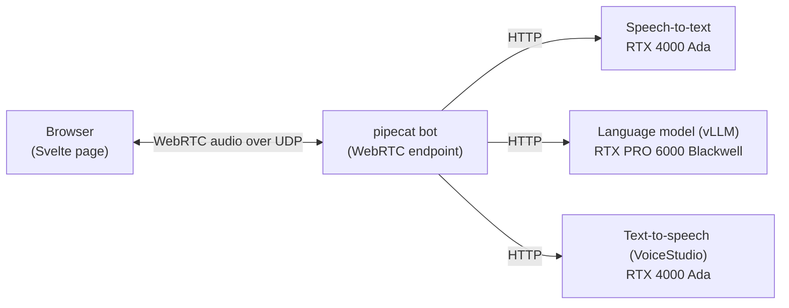

# Where the Voice Companion Loop runs: GPU VMs or LKE?

**Status:** decided 2026-10-01 · **Researched:** 2026-09-29 · **Revised:** 2026-09-29, adding option C
(a relay on a NodePort), validation jobs and an assessment; 2026-10-13, adding the LKE teardown caveat
and a runner note to validation job 1 · **Decides:** the compute platform for the demo on Akamai Cloud

> **Decision (2026-10-01):** the team chose **option C**, standard LKE with a relay on a NodePort. Its
> premises marked *(inferred)* are still untested, so [validation jobs](#validation-jobs) 1–6 are the
> first work items.

This document sets out the options and their trade-offs. The analysis makes no recommendation; the
authors' read comes last, in [Assessment](#assessment), kept apart from it. Every factual statement
cites a source checked on 2026-09-29, except sources 31 and 32, checked on 2026-10-13. Statements
marked *(inferred)* are reasoned from documented behavior and have not been tested on LKE;
[Validation jobs](#validation-jobs) says how to test them.

## At a glance

The Voice Companion Loop is a live demo. You talk to an AI character in a web browser, and it answers
in character, in a custom voice. Behind the page, three GPU-backed services do the work: speech-to-text,
a language model served by vLLM, and text-to-speech with VoiceStudio.

Nearly all of the demo's traffic is ordinary web traffic, which runs equally well on virtual machines or
on Kubernetes. **One link decides the platform question: the live audio between the browser and our
server.** Real-time audio in a browser uses WebRTC, which carries sound over UDP, a fast,
connectionless kind of network traffic. The browser needs a direct path to the server's UDP port.

On standard LKE, Akamai's managed Kubernetes, the usual front door for a service is a NodeBalancer, and
the standard NodeBalancer does not carry UDP [1]. The premium NodeBalancer does carry UDP, but it is
available only with LKE Enterprise, and its UDP support is in beta [1][2]. LKE Enterprise itself "is
only available to approved customers in limited regions" [3].

What standard LKE does offer for UDP is the NodePort: a port between 30000 and 32767, opened on every
node's public address [10]. NodePorts suit most UDP services, whose clients are told a fixed address in
advance. A WebRTC server is different. It announces its own address while each call is being set up,
and the library our bot uses can announce only its private pod address [7]. So on LKE, the audio needs
one of two things:

- host networking, where the bot borrows a node's public address; or
- a relay that the browser can reach, on a NodePort or through a load balancer, and that can reach the
  bot inside the cluster.

| | Option | In one line | Extra platform cost¹ | Approval or beta needed |
|---|---|---|---|---|
| **A** | GPU VMs + Docker | Each service runs in a container on a GPU VM; audio goes straight to a VM's public IP | none | no |
| **B** | Standard LKE, bot on the host network | Everything runs on LKE; the audio endpoint uses one node's public IP | ~$0–10/mo | no |
| **C** | Standard LKE, relay on a NodePort | Everything runs on LKE; audio passes through a relay inside the cluster, reached on a NodePort or over TLS through a standard NodeBalancer | ~$10–20/mo | no |
| **D** | Hybrid | GPU services run on LKE; the audio endpoint runs on a small VM | ~$20–45/mo | no |
| **E** | LKE Enterprise + relay | Everything runs on LKE Enterprise; audio passes through a relay behind a UDP load balancer | ~$465–630/mo | yes |

¹ Beyond the GPU nodes themselves, which cost the same in every option.

**Questions for the team**

1. Is showcasing LKE a goal of this demo, or is the goal the voice experience on Akamai GPUs?
2. Must a customer be able to reproduce the demo from the repository alone?
3. Can the demo depend on an approval-gated product or a beta feature?
4. How much machinery are we willing to keep healthy for a live, on-stage demo?

The authors' read is at the end, in [Assessment](#assessment): option C is the strongest way to run on
LKE, and option A remains the lowest-risk way onto the stage.

## How the demo works

Only the link between the browser and the bot is WebRTC. The GPU services talk plain HTTP to the bot
and have no special networking needs on any platform.

The bot uses pipecat's SmallWebRTC transport, which is built on the Python WebRTC library aiortc.
Three of aiortc's properties shape every option:

- **Random ports.** aiortc takes its UDP ports from the operating system at random [4], and they cannot
  be confined to a range: "You cannot limit the UDP ports used by ICE, they are picked randomly by the
  OS" [5]. A request to add a range has been open since 2021 [6]. On Linux the default range is
  32768–60999, which is 28,232 ports.
- **No public-address override.** It announces only the addresses on its own network interfaces. A
  request for finer control has been open since 2018 [7].
- **No TCP fallback.** "TCP candidates are not supported" [8]. On a network that blocks UDP, the only
  path is a TURN relay reached over TLS.

## The options

### A. GPU VMs + Docker

- **How it works.** Terraform creates GPU compute instances on a private VPC. A startup script installs
  the NVIDIA driver and container toolkit, then starts each service in a container. The bot shares its
  VM's network, so the address it announces is the VM's public IP.
- **What it shows customers.** Akamai GPU compute instances (RTX 4000 Ada and RTX PRO 6000 Blackwell),
  VPC, and Cloud Firewall.
- **What it takes.** A kernel setting and a firewall rule confine the audio ports. pipecat's own Docker
  example does the same with 101 ports [9].
- **Trade-offs.** It has the fewest moving parts, and the public IP lasts as long as the VM does. The
  team owns GPU driver installation, and the demo tells no Kubernetes story.

### B. Standard LKE, bot on the host network

- **How it works.** Every service runs as a pod, and the cluster has one GPU node pool per GPU class.
  The bot runs with host networking (`hostNetwork`): it shares one node's network and public IP, which
  LKE documents as reachable from the internet [10].
- **What it shows customers.** LKE with GPU node pools, and Cloud Firewall. On standard LKE, "the latest
  available NVIDIA drivers are automatically installed" [11].
- **What it takes.**
  - The NVIDIA device plugin or GPU Operator [11].
  - A Cloud Firewall. The standard LKE docs advise "consider applying firewall rules" and point to the
    cloud-firewall-controller, which then manages the rules [10].
  - A way to confine the audio ports. Kubernetes does not allow a host-networked pod to change its own
    port range [12]. So either 28,232 UDP ports are opened on the node, or a privileged DaemonSet
    narrows the port range for the whole node.
  - HTTPS for the page, for example through a standard NodeBalancer.
- **Trade-offs.**
  - It needs no approval or beta feature, and the whole demo runs on Kubernetes.
  - "Recycling a worker node deletes the corresponding Linode and deploys a new one" [13]. The bot
    announces its address afresh for each session, so after a recycle, new sessions pick up the node's
    new address, but sessions in progress drop *(inferred)*.
  - Kubernetes' Baseline pod-security profile, which some organizations enforce, disallows host
    networking [14].
  - pipecat publishes no Kubernetes example [15].

### C. Standard LKE, relay on a NodePort

- **How it works.** A TURN relay runs inside the cluster; STUNner is one built for Kubernetes.
  - Its UDP listener is exposed as a NodePort on the nodes' public addresses.
  - A TLS listener sits behind a standard NodeBalancer on port 443, for networks that block UDP.
  - The browser relays every session through it, and the relay reaches the bot at the bot's pod
    address. The bot stays an ordinary pod.
- **What it shows customers.** LKE with GPU node pools, standard NodeBalancers, Cloud Firewall, and a
  Kubernetes-native media relay, all without LKE Enterprise.
- **What it takes.**
  - STUNner. Its Service type can be set to NodePort, and it supports TURN over UDP and over TLS. The
    TLS listener needs a certificate [18].
  - The browser configured with the relay as its only TURN server, and the bot configured with none
    [29]. pipecat's browser client accepts TURN servers for each connection [30].
  - A firewall rule for the relay's one UDP NodePort [10].
  - The NVIDIA device plugin or GPU Operator [11].
  - A way to tell the browser the relay's current node address, which changes when nodes are recycled
    *(inferred)*.
- **Trade-offs.**
  - It needs no approval, beta feature or host networking, and the same relay also covers networks
    that block UDP.
  - Every session is relayed, and there are more components to run.
  - pipecat publishes no Kubernetes example [15]. STUNner's guide describes the pattern for media
    servers in general [29].
  - STUNner advises setting browsers to relay-only [29], a setting pipecat's browser client does not
    document [30].
- **A variant without a relay.** An ordinary pod may confine its own port range [12], and those ports
  can be mirrored one-to-one as NodePorts. However, aiortc cannot announce the node's public address
  [7], so the call setup would need custom rewriting. This is untested *(inferred)*, and networks that
  block UDP would still need a relay.

### D. Hybrid: GPU services on LKE, bot on a VM

- **How it works.** vLLM and VoiceStudio run as pods on LKE GPU node pools. The bot and the web page
  run on a small compute instance with a stable public IP, as in option A.
- **What it shows customers.** LKE GPU node pools and compute instances, side by side.
- **What it takes.** Two provisioning models in one deployment. Standard LKE has no VPC isolation
  ("VPC isolated networking: No") [16]. So the bot reaches the GPU services from outside a private
  network, and those endpoints need TLS and authentication *(inferred)*. Costs: one or two standard
  NodeBalancers at $10/mo each, and a small instance at $12–24/mo [17].
- **Trade-offs.** The audio path is the same as option A's, and LKE is still showcased. The cost is a
  second lifecycle to manage, and service traffic that leaves the private network.

### E. LKE Enterprise with an in-cluster relay

- **How it works.** Every session's audio passes through a TURN relay running inside the cluster,
  exposed by premium NodeBalancers. The bot stays an ordinary pod.
- **What it shows customers.** LKE Enterprise, premium NodeBalancers carrying UDP, and a media path
  that is entirely Kubernetes-native.
- **What it takes.**
  - LKE Enterprise: approval, limited regions [3], and $300/mo for the control plane [17].
  - Premium NodeBalancers at $0.225/hr, about $164/mo each [17]:
    - UDP on them "is a BETA feature", configured through the API.
    - Editing their TCP settings in Cloud Manager overwrites the UDP configuration [2].
    - STUNner puts one protocol on each load balancer by default, so UDP plus TLS means two. An
      annotation lets a single one carry both [18].
  - The NVIDIA drivers, which LKE Enterprise does not install automatically [11].
- **Trade-offs.**
  - The relay pattern is the same as option C's. The difference is that the UDP entry is a
    load-balanced address rather than node addresses.
  - The option has the highest cost, an approval step and a beta dependency.
  - A customer can reproduce it only with LKE Enterprise access.

## Side by side

| | A: GPU VMs | B: LKE, host network | C: LKE, relay on a NodePort | D: Hybrid | E: LKE Enterprise + relay |
|---|---|---|---|---|---|
| Audio path | direct to a VM | direct to a node | relayed inside the cluster | direct to a VM | relayed inside the cluster |
| Where the browser sends audio | the VM's IP, stable for its life | the bot's node, which changes on recycle *(inferred)* | any node's NodePort, or the TLS NodeBalancer's IP | the VM's IP, stable for its life | the NodeBalancer's IP |
| Added pieces to run | driver setup at boot | GPU plugin, firewall controller, port-range DaemonSet, HTTPS | GPU plugin, STUNner, TLS NodeBalancer, relay-address hand-out | NodeBalancers, a second lifecycle | GPU Operator, STUNner, premium NodeBalancers |
| Extra platform cost | none | ~$0–10/mo | ~$10–20/mo | ~$20–45/mo | ~$465–630/mo |
| Approval or beta | no | no | no | no | both |
| Kubernetes host networking | n/a | yes | no | n/a | no |
| Customer can reproduce from the repo | yes | yes | yes | yes | with LKE Enterprise access |
| Published guidance to follow | pipecat's Docker example | none for Kubernetes | STUNner's docs | pipecat's Docker example, for the bot | STUNner's docs |

## Common to every option

- **Networks that block UDP.** Conference and corporate networks sometimes block UDP, and aiortc has no
  TCP fallback [8]. The browser must then reach a TURN relay over TLS on port 443, and the relay needs a
  real certificate.
  - Every option needs such a relay. In options C and E, the in-cluster relay fills that role.
  - The only published figure is old. Across callstats.io's customers from January 2015 to February
    2016, "22% of the conferences need some kind of TURN relay server" and "about 9% of the
    conferences required TCP" [19]. No source gives a figure for conference venues.
- **HTTPS.** "The getUserMedia() method is only available in secure contexts" [20], so the microphone
  works only on an HTTPS page.
- **One region.** Both GPU classes must be in the same region, because a VPC and an LKE cluster are each
  regional.
  - Akamai lists both classes in Chicago, Osaka, Paris, Seattle and Singapore. Paris and Singapore each
    have two data centers, so confirm the exact region.
  - The RTX PRO 6000 Blackwell has "limited deployment availability", and a $100 deposit may apply to
    newer accounts [21].
- **GPU billing.** Since July 1, 2026, GPU instances are billed "for actual hours used each month, with
  no monthly price cap", and they keep billing while powered off [22]. Standard LKE node pools cannot
  scale below one node [13]. Tearing down any option means deleting the GPU nodes.
- **Teardown on LKE.** Deleting an LKE cluster removes the Linodes in its node pools, but its
  "NodeBalancers and Block Storage volumes" stay on the account and must be deleted manually "to avoid
  further charges" [31]. In options B to E, tearing down to zero means deleting those as well.
- **Relay delay.** A relay in the same region adds little delay compared with speech recognition, the
  language model and speech synthesis *(inferred)*.

## Technical findings

| Finding | Detail | Sources |
|---|---|---|
| No UDP load balancing on standard LKE | Standard NodeBalancers: UDP "Not supported". Premium NodeBalancers "are available only for use with LKE-Enterprise (LKE-E)"; their UDP support is "a BETA feature", announced 2025-07-02 | [1][2] |
| NodePort is standard LKE's public UDP path | NodePort Services "listen on all Nodes with ports in the range 30000-32768" and are reachable from the internet. They suit services whose clients are told a fixed address in advance. A WebRTC server announces its own address during call setup, and aiortc announces only its interface (pod) addresses | [10][7] |
| An ordinary pod can't be reached directly | A pod announces its pod IP, which a browser can't route to. Standard LKE uses Calico [16], whose NAT rules add `--random-fully` where the host supports it [23], giving each destination a new random source port. RFC 4787: "Failure to meet REQ-1 will force the use of a UDP relay" [24]. Expected: every session needs host networking or a relay *(inferred; not tested on LKE)* | [16][23][24] |
| A relay can sit behind a NodePort | STUNner's Service type is configurable, including NodePort, and it supports TURN over UDP, TCP, TLS and DTLS. In its model the media server configures no STUN or TURN server and announces its pod address | [18][29] |
| Relaying from the bot has an open bug | aiortc's ICE library drops TURN "Data Indication" messages, and the reporter saw "zero media bytes flow" against Twilio's TURN service (open since 2026-05-23). No option here has the bot relay: in A, B and D it has a public address, and in C and E it configures no TURN server *(inferred)* | [25][29] |
| A pod can confine its ports; a host-networked pod can't | `net.ipv4.ip_local_port_range` is a "safe" sysctl, allowed in ordinary pods, but "the `net.*` sysctls are not allowed with host networking enabled". Services expose individual ports; the request to support ranges was closed without being implemented on 2026-07-16 | [12][26] |
| Node addresses aren't fixed | A recycle deletes the node's Linode and deploys a new one; shrinking a pool erases local storage | [13] |
| VPC | Standard LKE: "VPC isolated networking: No". LKE Enterprise routes pods natively over a VPC, uses Cilium, and adds a Cloud Firewall to every cluster | [16][3] |
| Industry practice | LiveKit, an established open-source WebRTC server, requires host networking on Kubernetes, which limits it to one pod per node. It does not support private clusters, whose extra layers of NAT make them "unsuitable for WebRTC traffic" | [27] |
| pipecat's positioning | For self-hosting, SmallWebRTC is "the recommended approach". pipecat advises other transports when "scaling beyond a handful of concurrent sessions", and has no official Kubernetes example | [28][15] |
| GPUs on standard LKE | Node pools support the RTX PRO 6000 Blackwell and the RTX 4000 Ada. Drivers are installed automatically on standard clusters, but not on LKE Enterprise | [11] |

## Validation jobs

Each job settles one open question, and none needs the finished demo, so they can run in parallel.
Sizes are rough estimates: **S** is a few hours, **M** about a day.

| # | Job | Settles | Options | Size | Owner |
|---|---|---|---|---|---|
| 1 | Relay path with pipecat on standard LKE | Does a relay on a NodePort carry pipecat's audio, given that pipecat's browser client documents no relay-only setting? | C, E | M | |
| 2 | Client on a UDP-blocked network | Does audio flow when the browser can reach the relay only over TLS on port 443? | all | S | |
| 3 | NAT behavior from a pod | Would a STUN server alone work from an ordinary pod, making the relay unnecessary? | C, E | S | |
| 4 | Node recycle | Does a recycled node keep its public IP? How long does a recycle take, and what happens to a call in progress? | B, C | S | |
| 5 | GPU regions for our account | Which regions offer both GPU classes, as instances and as LKE node pools? | all | S | |
| 6 | GPU pools on standard LKE | Do the preinstalled drivers run our images: VoiceStudio (CUDA 12.8) on the Ada, vLLM on the Blackwell? | B, C, D | M | |
| 7 | Baseline on a VM | Does a pipecat bot on a VM, with confined ports and a matching firewall rule, carry audio from another network? | A, D | S | |
| 8 | LKE Enterprise inquiry | How long approval takes, which GPU plans are offered, how nodes are addressed, and when UDP on premium NodeBalancers leaves beta | E | S | |

**How to run each job**

1. **Relay path with pipecat.**
   - On a small standard LKE cluster (CPU nodes are enough), install STUNner with a UDP Gateway on a
     NodePort and a TLS Gateway behind a standard NodeBalancer [18].
   - Deploy a minimal pipecat bot as an ordinary pod, and give pipecat's browser client STUNner as its
     only TURN server [29][30].
   - Give the bot itself no ICE servers, so that it "gathers host candidates only" [32], as STUNner's
     model expects [29]. Do not give the relay to pipecat's development runner: it takes ICE servers at
     startup, "uses these for its own candidate gathering and hands them to the client in the `/start`
     response, so both ends of the connection use the same servers" [32], and a bot that relays meets
     the open aioice bug [25]. Set the relay on the browser client's connection alone [30].
   - *Pass:* two-way audio, with the browser's WebRTC statistics (`chrome://webrtc-internals` in
     Chrome) showing a relayed candidate pair. Note how long connecting takes.
2. **UDP-blocked client.** Block outbound UDP on a test laptop and connect through a TLS relay: STUNner's
   TLS listener for C or E, or a TURN server on port 443 for A, B or D. *Pass:* audio flows, and the
   statistics show a relay reached over TLS.
3. **NAT behavior.** From an ordinary pod on standard LKE, query two public STUN servers and compare the
   mapped ports. Different ports mean every session needs a relay or host networking. The same port
   means a STUN-only design may work where UDP is open.
4. **Node recycle.** Record a node's public IP, keep a test call running through that node, then recycle
   it [13]. Compare the IPs, time the recycle, and note what the call does.
5. **GPU regions.** With an authenticated API token or Cloud Manager, list where both GPU plans can be
   deployed, as instances and as node pools. Start with Chicago, Osaka, Paris, Seattle and Singapore
   [21].
6. **GPU pools.**
   - Create a standard cluster with one RTX 4000 Ada pool and one RTX PRO 6000 Blackwell pool.
   - Install the NVIDIA device plugin, or the GPU Operator with its driver install disabled [11].
   - Run each service's image on its GPU. *Pass:* both services see their GPU and answer a request.
   - Delete the pools afterwards: GPU nodes bill by the hour [22].
7. **VM baseline.** On a compute instance, run a minimal pipecat bot in Docker with host networking, a
   confined port range set on the host, and a matching Cloud Firewall rule [9]. The network test needs
   no GPU. *Pass:* two-way audio from a browser on another network.
8. **LKE Enterprise inquiry.** Put the four questions to the LKE Enterprise team.

## What would change this picture

- Premium NodeBalancers, with UDP, reaching standard LKE, or their UDP support leaving beta.
- aiortc gaining port-range or public-address support; both requests are open [6][7].
- pipecat publishing a Kubernetes deployment recipe.

## Assessment

*The authors' read, kept apart from the analysis above. The decision remains the team's.*

- **Option C is the strongest way to run the demo on LKE.**
  - It needs no approval, beta feature or host networking, and every pod stays ordinary.
  - Its one relay also covers networks that block UDP.
  - It adds about $10–20 a month.
  - Its costs are real but bounded: a relay on every session, STUNner to operate, and handing the
    browser a node address that changes on recycle.
- **Option A remains the lowest-risk way onto the stage.** It has the fewest moving parts and follows
  pipecat's published Docker example. It shows GPU instances, not LKE.
- **Against C, the other LKE options give up more than they gain for this demo.**
  - B needs host networking, plus either a privileged DaemonSet or 28,232 open ports, to do what C does
    with ordinary pods.
  - D pays for two lifecycles and service traffic outside a private network, to keep the audio on a VM
    as A already does.
  - E costs about $445–620 a month more than C for a load-balanced UDP address, behind an approval step
    and a beta feature.
- **Between A and C, questions 1 and 4 in [At a glance](#at-a-glance) decide it.** If showcasing LKE
  matters, C earns its extra machinery. If keeping the on-stage machinery small matters most, A does.
  Validation jobs 1 and 2 will show whether C's relay path is as solid as the analysis suggests.
- **Suggested order for the validation jobs:**
  - Start jobs 1 and 2 now. They decide C and the fallback for UDP-blocked networks, and neither needs
    a GPU.
  - Run jobs 3 and 4 alongside them; both are small.
  - Run job 5 before anyone picks a region.
  - Run job 6 or 7 once the team leans one way.
  - Run job 8 only if E stays in contention.

## Glossary

- **WebRTC:** the browser standard for real-time audio and video.
- **UDP:** fast, connectionless network traffic, which real-time audio relies on.
- **NAT:** address translation between a private network and a public address. How it assigns ports
  decides whether a direct audio path works.
- **STUN / TURN:** STUN tells a device its public address; TURN relays traffic when no direct path
  exists.
- **NodeBalancer:** Akamai's managed load balancer. Standard NodeBalancers carry TCP and HTTP; premium
  NodeBalancers add UDP and require LKE Enterprise.
- **NodePort:** a Kubernetes service type that opens the same port, between 30000 and 32767, on every
  node's public address.
- **LKE / LKE Enterprise:** Akamai's managed Kubernetes, in its standard and enterprise tiers.
- **Host networking:** a pod sharing its node's network and public IP.
- **Node recycle:** LKE replacing a node with a fresh one, for example during an upgrade.

## Availability caveat

GPU availability, including RTX PRO 6000 Blackwell node pools on LKE, was verified against one Akamai
account on 2026-09-29. Confirm it in your own account and region.

## Sources

Checked 2026-09-29, except 31 and 32, checked 2026-10-13.

1. Akamai, NodeBalancer types and features: https://techdocs.akamai.com/cloud-computing/docs/nodebalancer
2. Akamai API changelog, UDP support for NodeBalancers (2025-07-02): https://techdocs.akamai.com/linode-api/changelog/nodebalancers-udp-support
3. Akamai, LKE Enterprise: https://techdocs.akamai.com/cloud-computing/docs/lke-enterprise
4. aioice source, candidate sockets bound to an OS-assigned port: https://github.com/aiortc/aioice/blob/main/src/aioice/ice.py
5. aiortc issue #487, limiting ICE ports: https://github.com/aiortc/aiortc/issues/487
6. aioice issue #47, limiting the ephemeral port range (open): https://github.com/aiortc/aioice/issues/47
7. aioice issue #2, finer local candidate address selection (open): https://github.com/aiortc/aioice/issues/2
8. aiortc issue #443, TCP ICE candidates: https://github.com/aiortc/aiortc/issues/443
9. pipecat-examples, SmallWebRTC in Docker: https://github.com/pipecat-ai/pipecat-examples/blob/main/p2p-webrtc/docker/README.md
10. Akamai, LKE network and firewall details: https://techdocs.akamai.com/cloud-computing/docs/lke-network-firewall-details
11. Akamai, GPUs on LKE: https://techdocs.akamai.com/cloud-computing/docs/gpus-on-lke
12. Kubernetes, using sysctls in a cluster: https://kubernetes.io/docs/tasks/administer-cluster/sysctl-cluster/
13. Akamai, manage nodes and node pools: https://techdocs.akamai.com/cloud-computing/docs/manage-nodes-and-node-pools
14. Kubernetes, Pod Security Standards: https://kubernetes.io/docs/concepts/security/pod-security-standards/
15. pipecat issue #2685, deploying WebRTC on Kubernetes: https://github.com/pipecat-ai/pipecat/issues/2685
16. Akamai, Linode Kubernetes Engine overview: https://techdocs.akamai.com/cloud-computing/docs/linode-kubernetes-engine
17. Akamai pricing APIs: https://api.linode.com/v4/nodebalancers/types, https://api.linode.com/v4/lke/types, https://api.linode.com/v4/linode/types
18. STUNner, Gateway reference: https://github.com/l7mp/stunner/blob/main/docs/GATEWAY.md
19. Lumiaho and Singh, callstats.io data via webrtcHacks (2016): https://webrtchacks.com/usage-stats/
20. MDN, MediaDevices.getUserMedia(): https://developer.mozilla.org/en-US/docs/Web/API/MediaDevices/getUserMedia
21. Akamai, GPU compute instances: https://techdocs.akamai.com/cloud-computing/docs/gpu-compute-instances
22. Akamai, understanding how billing works: https://techdocs.akamai.com/cloud-computing/docs/understanding-how-billing-works
23. Calico source, NAT actions: https://github.com/projectcalico/calico/blob/master/felix/iptables/actions.go
24. RFC 4787, NAT behavioral requirements for unicast UDP (§4.1, REQ-1): https://www.rfc-editor.org/rfc/rfc4787
25. aioice issue #110, TURN Data Indications dropped (open): https://github.com/aiortc/aioice/issues/110
26. Kubernetes issue #23864, port ranges in Services: https://github.com/kubernetes/kubernetes/issues/23864
27. LiveKit, deploying to Kubernetes: https://docs.livekit.io/transport/self-hosting/kubernetes
28. pipecat, choosing a transport: https://docs.pipecat.ai/client/concepts/choosing-a-transport
29. STUNner, deployment models: https://github.com/l7mp/stunner/blob/main/docs/DEPLOYMENT.md
30. pipecat, SmallWebRTC transport for the JavaScript client: https://docs.pipecat.ai/api-reference/client/js/transports/small-webrtc
31. Akamai API reference, delete a Kubernetes cluster: https://techdocs.akamai.com/linode-api/reference/delete-lke-cluster
32. pipecat, SmallWebRTC transport for the server and its development runner: https://docs.pipecat.ai/api-reference/server/services/transport/small-webrtc
