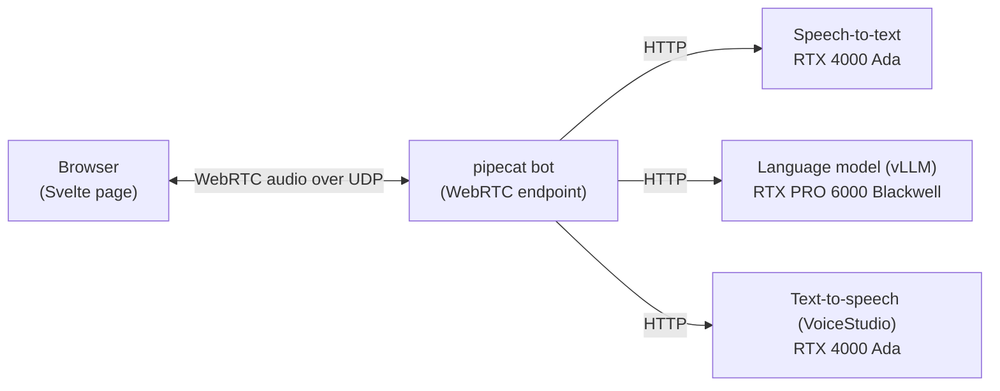

# Where the Voice Companion Loop runs: GPU VMs or LKE?

**Status:** open for team decision · **Researched:** 2026-09-29 · **Decides:** the compute platform for the demo on Akamai Cloud

This document sets out the options and their trade-offs. It makes no recommendation. Every factual
statement cites a source checked on 2026-09-29. Statements marked *(inferred)* are reasoned from
documented behavior and have not been tested on LKE;
[Open questions](#open-questions-and-how-to-settle-them) says how to test them.

## At a glance

The Voice Companion Loop is a live demo. You talk to an AI character in a web browser, and it answers
in character, in a custom voice. Behind the page, three GPU-backed services do the work: speech-to-text,
a language model served by vLLM, and text-to-speech with VoiceStudio.

Nearly all of the demo's traffic is ordinary web traffic, which runs equally well on virtual machines or
on Kubernetes. **One link decides the platform question: the live audio between the browser and our
server.** Real-time audio in a browser uses WebRTC, which carries sound over UDP, a fast,
connectionless kind of network traffic. The browser needs a direct path to the server's UDP port.

On standard LKE, Akamai's managed Kubernetes, the usual front door for a service is a NodeBalancer, and
the standard NodeBalancer does not carry UDP [1]. The premium NodeBalancer does carry UDP, but it is
available only with LKE Enterprise, and its UDP support is in beta [1][2]. LKE Enterprise itself "is
only available to approved customers in limited regions" [3]. So running the demo on LKE means choosing
a way around the missing UDP front door, and each way has a cost.

| | Option | In one line | Extra platform cost¹ | Approval or beta needed |
|---|---|---|---|---|
| **A** | GPU VMs + Docker | Each service runs in a container on a GPU VM; audio goes straight to a VM's public IP | none | no |
| **B** | Standard LKE, bot on the host network | Everything runs on LKE; the audio endpoint uses one node's public IP | ~$0–10/mo | no |
| **C** | Hybrid | GPU services run on LKE; the audio endpoint runs on a small VM | ~$20–45/mo | no |
| **D** | LKE Enterprise + in-cluster relay | Everything runs on LKE Enterprise; all audio passes through a relay behind a UDP load balancer | ~$465–630/mo | yes |

¹ Beyond the GPU nodes themselves, which cost the same in every option.

**Questions for the team**

1. Is showcasing LKE a goal of this demo, or is the goal the voice experience on Akamai GPUs?
2. Must a customer be able to reproduce the demo from the repository alone?
3. Can the demo depend on an approval-gated product or a beta feature?
4. How much machinery are we willing to keep healthy for a live, on-stage demo?

## How the demo works

Only the link between the browser and the bot is WebRTC. The GPU services talk plain HTTP to the bot
and have no special networking needs on any platform.

The bot uses pipecat's SmallWebRTC transport, which is built on the Python WebRTC library aiortc.
Three of aiortc's properties shape every option:

- **Random ports.** aiortc takes its UDP ports from the operating system at random [4], and they cannot
  be confined to a range: "You cannot limit the UDP ports used by ICE, they are picked randomly by the
  OS" [5]. A request to add a range has been open since 2021 [6]. On Linux the default range is
  32768–60999, which is 28,232 ports.
- **No public-address override.** It announces only the addresses on its own network interfaces. A
  request for finer control has been open since 2018 [7].
- **No TCP fallback.** "TCP candidates are not supported" [8]. On a network that blocks UDP, the only
  path is a TURN relay reached over TLS.

## The options

### A. GPU VMs + Docker

- **How it works.** Terraform creates GPU compute instances on a private VPC. A startup script installs
  the NVIDIA driver and container toolkit, then starts each service in a container. The bot shares its
  VM's network, so the address it announces is the VM's public IP.
- **What it shows customers.** Akamai GPU compute instances (RTX 4000 Ada and RTX PRO 6000 Blackwell),
  VPC, and Cloud Firewall.
- **What it takes.** A kernel setting and a firewall rule confine the audio ports. pipecat's own Docker
  example does the same with 101 ports [9].
- **Trade-offs.** It has the fewest moving parts, and the public IP lasts as long as the VM does. The
  team owns GPU driver installation, and the demo tells no Kubernetes story.

### B. Standard LKE, bot on the host network

- **How it works.** Every service runs as a pod, and the cluster has one GPU node pool per GPU class.
  The bot runs with host networking (`hostNetwork`): it shares one node's network and public IP, which
  LKE documents as reachable from the internet [10].
- **What it shows customers.** LKE with GPU node pools, and Cloud Firewall. On standard LKE, "the latest
  available NVIDIA drivers are automatically installed" [11].
- **What it takes.**
  - The NVIDIA device plugin or GPU Operator [11].
  - A Cloud Firewall. The standard LKE docs advise "consider applying firewall rules" and point to the
    cloud-firewall-controller, which then manages the rules [10].
  - A way to confine the audio ports. Kubernetes does not allow a host-networked pod to change its own
    port range [12]. So either 28,232 UDP ports are opened on the node, or a privileged DaemonSet
    narrows the port range for the whole node.
  - HTTPS for the page, and DNS pointing at the bot's node.
- **Trade-offs.** It needs no approval or beta feature, and the whole demo runs on Kubernetes. However,
  "recycling a worker node deletes the corresponding Linode and deploys a new one" [13]. So the bot's
  public IP changes whenever its node is recycled, for example during a version upgrade *(inferred)*.
  Kubernetes' Baseline pod-security profile, which some organizations enforce, disallows host
  networking [14]. pipecat publishes no Kubernetes example [15].

### C. Hybrid: GPU services on LKE, bot on a VM

- **How it works.** vLLM and VoiceStudio run as pods on LKE GPU node pools. The bot and the web page
  run on a small compute instance with a stable public IP, as in option A.
- **What it shows customers.** LKE GPU node pools and compute instances, side by side.
- **What it takes.** Two provisioning models in one deployment. Standard LKE has no VPC isolation
  ("VPC isolated networking: No") [16]. So the bot reaches the GPU services from outside a private
  network, and those endpoints need TLS and authentication *(inferred)*. Costs: one or two standard
  NodeBalancers at $10/mo each, and a small instance at $12–24/mo [17].
- **Trade-offs.** The audio path is the same as option A's, and LKE is still showcased. The cost is a
  second lifecycle to manage, and service traffic that leaves the private network.

### D. LKE Enterprise with an in-cluster relay

- **How it works.** Every session's audio passes through a TURN relay running inside the cluster,
  exposed by premium NodeBalancers. STUNner is one Kubernetes-native relay. The bot stays an ordinary
  pod.
- **What it shows customers.** LKE Enterprise, premium NodeBalancers carrying UDP, and a media path
  that is entirely Kubernetes-native.
- **What it takes.**
  - LKE Enterprise: approval, limited regions [3], and $300/mo for the control plane [17].
  - Premium NodeBalancers at $0.225/hr, about $164/mo each [17]:
    - UDP on them "is a BETA feature", configured through the API.
    - Editing their TCP settings in Cloud Manager overwrites the UDP configuration [2].
    - STUNner puts one protocol on each load balancer by default, so UDP plus TLS means two. An
      annotation lets a single one carry both [18].
  - The NVIDIA drivers, which LKE Enterprise does not install automatically [11].
- **Trade-offs.** A single stable entry point receives all audio, and it can also serve UDP-blocked
  networks if it listens over TLS. The option has the highest cost, an approval step and a beta
  dependency. A customer can reproduce it only with LKE Enterprise access.

## Side by side

| | A: GPU VMs | B: LKE, host-network bot | C: Hybrid | D: LKE Enterprise + relay |
|---|---|---|---|---|
| Audio path | direct to a VM | direct to a node | direct to a VM | relayed through a load balancer |
| Audio address is stable | for the VM's life | until its node is recycled *(inferred)* | for the VM's life | yes: the NodeBalancer's IP |
| Added pieces to run | driver setup at boot | GPU plugin, firewall controller, port-range DaemonSet, HTTPS, DNS | NodeBalancers, a second lifecycle | GPU Operator, STUNner, premium NodeBalancers |
| Extra platform cost | none | ~$0–10/mo | ~$20–45/mo | ~$465–630/mo |
| Approval or beta | no | no | no | both |
| Customer can reproduce from the repo | yes | yes | yes | with LKE Enterprise access |
| Published guidance to follow | pipecat's Docker example | none for Kubernetes | pipecat's Docker example, for the bot | STUNner's docs |

## Common to every option

- **Networks that block UDP.** Conference and corporate networks sometimes block UDP, and aiortc has no
  TCP fallback [8]. The browser must then reach a TURN relay over TLS on port 443, and the relay needs a
  real certificate.
  - Every option needs such a relay. In option D, the in-cluster relay can fill that role.
  - The only published figure is old. Across callstats.io's customers from January 2015 to February
    2016, "22% of the conferences need some kind of TURN relay server" and "about 9% of the
    conferences required TCP" [19]. No source gives a figure for conference venues.
- **HTTPS.** "The getUserMedia() method is only available in secure contexts" [20], so the microphone
  works only on an HTTPS page.
- **One region.** Both GPU classes must be in the same region, because a VPC and an LKE cluster are each
  regional.
  - Akamai lists both classes in Chicago, Osaka, Paris, Seattle and Singapore. Paris and Singapore each
    have two data centers, so confirm the exact region.
  - The RTX PRO 6000 Blackwell has "limited deployment availability", and a $100 deposit may apply to
    newer accounts [21].
- **GPU billing.** Since July 1, 2026, GPU instances are billed "for actual hours used each month, with
  no monthly price cap", and they keep billing while powered off [22]. Standard LKE node pools cannot
  scale below one node [13]. Tearing down any option means deleting the GPU nodes.
- **Relay delay.** A relay in the same region adds little delay compared with speech recognition, the
  language model and speech synthesis *(inferred)*.

## Technical findings

| Finding | Detail | Sources |
|---|---|---|
| No UDP load balancing on standard LKE | Standard NodeBalancers: UDP "Not supported". Premium NodeBalancers "are available only for use with LKE-Enterprise (LKE-E)"; their UDP support is "a BETA feature", announced 2025-07-02 | [1][2] |
| An ordinary pod can't be reached directly | A pod announces its pod IP, which a browser can't route to. Standard LKE uses Calico [16], whose NAT rules add `--random-fully` where the host supports it [23], giving each destination a new random source port. RFC 4787: "Failure to meet REQ-1 will force the use of a UDP relay" [24]. Expected: every session needs host networking or a relay *(inferred; not tested on LKE)* | [16][23][24] |
| Relaying from the bot has an open bug | aiortc's ICE library drops TURN "Data Indication" messages, and the reporter saw "zero media bytes flow" against Twilio's TURN service. Open since 2026-05-23; untested against other TURN servers | [25] |
| Port ranges don't fit Kubernetes Services | Services expose individual ports; the request to support ranges was closed without being implemented on 2026-07-16. NodePorts span 30000–32767 across the whole cluster | [26][10] |
| Node addresses aren't fixed | A recycle deletes the node's Linode and deploys a new one; shrinking a pool erases local storage | [13] |
| VPC | Standard LKE: "VPC isolated networking: No". LKE Enterprise routes pods natively over a VPC, uses Cilium, and adds a Cloud Firewall to every cluster | [16][3] |
| Industry practice | LiveKit, an established open-source WebRTC server, requires host networking on Kubernetes, which limits it to one pod per node. It does not support private clusters, whose extra layers of NAT make them "unsuitable for WebRTC traffic" | [27] |
| pipecat's positioning | For self-hosting, SmallWebRTC is "the recommended approach". pipecat advises other transports when "scaling beyond a handful of concurrent sessions", and has no official Kubernetes example | [28][15] |
| GPUs on standard LKE | Node pools support the RTX PRO 6000 Blackwell and the RTX 4000 Ada. Drivers are installed automatically on standard clusters, but not on LKE Enterprise | [11] |

## Open questions and how to settle them

| Question | Matters for | How to settle it |
|---|---|---|
| Does the public address a pod learns from a STUN server work through LKE's NAT? | B, D | From a pod, query two STUN servers: different mapped ports mean a relay is required |
| Does a recycled node keep its public IP? | B | Note a node's IP, recycle the node, compare |
| Does aiortc relay through coturn despite the open bug? | any option where the bot relays | Force relay-only on the bot against a coturn server |
| Which regions offer both GPU classes to our account, on VMs and on LKE? | all | Run an authenticated region-availability query |
| For LKE Enterprise: how long approval takes, which GPU plans are offered, and how nodes are addressed | D | Ask the LKE Enterprise team |

## What would change this picture

- Premium NodeBalancers, with UDP, reaching standard LKE, or their UDP support leaving beta.
- aiortc gaining port-range or public-address support; both requests are open [6][7].
- pipecat publishing a Kubernetes deployment recipe.

## Glossary

- **WebRTC:** the browser standard for real-time audio and video.
- **UDP:** fast, connectionless network traffic, which real-time audio relies on.
- **NAT:** address translation between a private network and a public address. How it assigns ports
  decides whether a direct audio path works.
- **STUN / TURN:** STUN tells a device its public address; TURN relays traffic when no direct path
  exists.
- **NodeBalancer:** Akamai's managed load balancer. Standard NodeBalancers carry TCP and HTTP; premium
  NodeBalancers add UDP and require LKE Enterprise.
- **LKE / LKE Enterprise:** Akamai's managed Kubernetes, in its standard and enterprise tiers.
- **Host networking:** a pod sharing its node's network and public IP.
- **Node recycle:** LKE replacing a node with a fresh one, for example during an upgrade.

## Availability caveat

GPU availability, including RTX PRO 6000 Blackwell node pools on LKE, was verified against one Akamai
account on 2026-09-29. Confirm it in your own account and region.

## Sources

Checked 2026-09-29.

1. Akamai, NodeBalancer types and features: https://techdocs.akamai.com/cloud-computing/docs/nodebalancer
2. Akamai API changelog, UDP support for NodeBalancers (2025-07-02): https://techdocs.akamai.com/linode-api/changelog/nodebalancers-udp-support
3. Akamai, LKE Enterprise: https://techdocs.akamai.com/cloud-computing/docs/lke-enterprise
4. aioice source, candidate sockets bound to an OS-assigned port: https://github.com/aiortc/aioice/blob/main/src/aioice/ice.py
5. aiortc issue #487, limiting ICE ports: https://github.com/aiortc/aiortc/issues/487
6. aioice issue #47, limiting the ephemeral port range (open): https://github.com/aiortc/aioice/issues/47
7. aioice issue #2, finer local candidate address selection (open): https://github.com/aiortc/aioice/issues/2
8. aiortc issue #443, TCP ICE candidates: https://github.com/aiortc/aiortc/issues/443
9. pipecat-examples, SmallWebRTC in Docker: https://github.com/pipecat-ai/pipecat-examples/blob/main/p2p-webrtc/docker/README.md
10. Akamai, LKE network and firewall details: https://techdocs.akamai.com/cloud-computing/docs/lke-network-firewall-details
11. Akamai, GPUs on LKE: https://techdocs.akamai.com/cloud-computing/docs/gpus-on-lke
12. Kubernetes, using sysctls in a cluster: https://kubernetes.io/docs/tasks/administer-cluster/sysctl-cluster/
13. Akamai, manage nodes and node pools: https://techdocs.akamai.com/cloud-computing/docs/manage-nodes-and-node-pools
14. Kubernetes, Pod Security Standards: https://kubernetes.io/docs/concepts/security/pod-security-standards/
15. pipecat issue #2685, deploying WebRTC on Kubernetes: https://github.com/pipecat-ai/pipecat/issues/2685
16. Akamai, Linode Kubernetes Engine overview: https://techdocs.akamai.com/cloud-computing/docs/linode-kubernetes-engine
17. Akamai pricing APIs: https://api.linode.com/v4/nodebalancers/types, https://api.linode.com/v4/lke/types, https://api.linode.com/v4/linode/types
18. STUNner, Gateway reference: https://github.com/l7mp/stunner/blob/main/docs/GATEWAY.md
19. Lumiaho and Singh, callstats.io data via webrtcHacks (2016): https://webrtchacks.com/usage-stats/
20. MDN, MediaDevices.getUserMedia(): https://developer.mozilla.org/en-US/docs/Web/API/MediaDevices/getUserMedia
21. Akamai, GPU compute instances: https://techdocs.akamai.com/cloud-computing/docs/gpu-compute-instances
22. Akamai, understanding how billing works: https://techdocs.akamai.com/cloud-computing/docs/understanding-how-billing-works
23. Calico source, NAT actions: https://github.com/projectcalico/calico/blob/master/felix/iptables/actions.go
24. RFC 4787, NAT behavioral requirements for unicast UDP (§4.1, REQ-1): https://www.rfc-editor.org/rfc/rfc4787
25. aioice issue #110, TURN Data Indications dropped (open): https://github.com/aiortc/aioice/issues/110
26. Kubernetes issue #23864, port ranges in Services: https://github.com/kubernetes/kubernetes/issues/23864
27. LiveKit, deploying to Kubernetes: https://docs.livekit.io/transport/self-hosting/kubernetes
28. pipecat, choosing a transport: https://docs.pipecat.ai/client/concepts/choosing-a-transport
